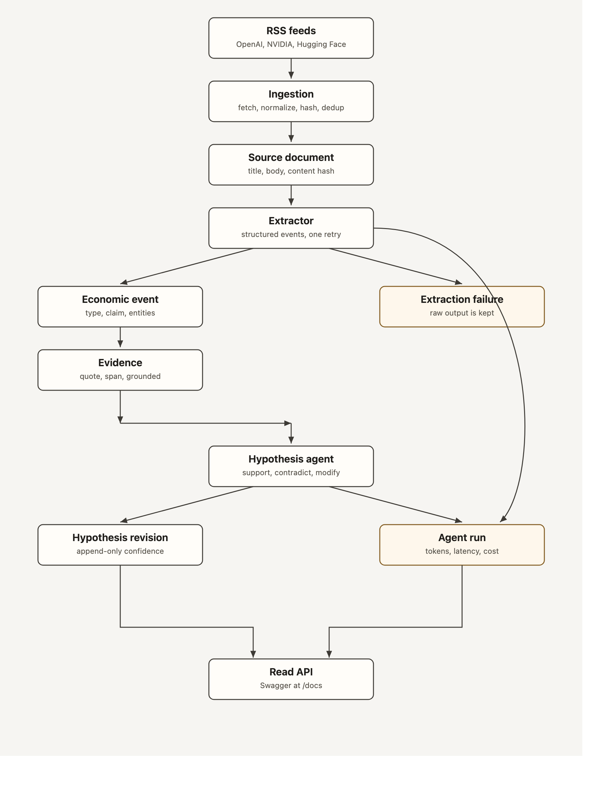
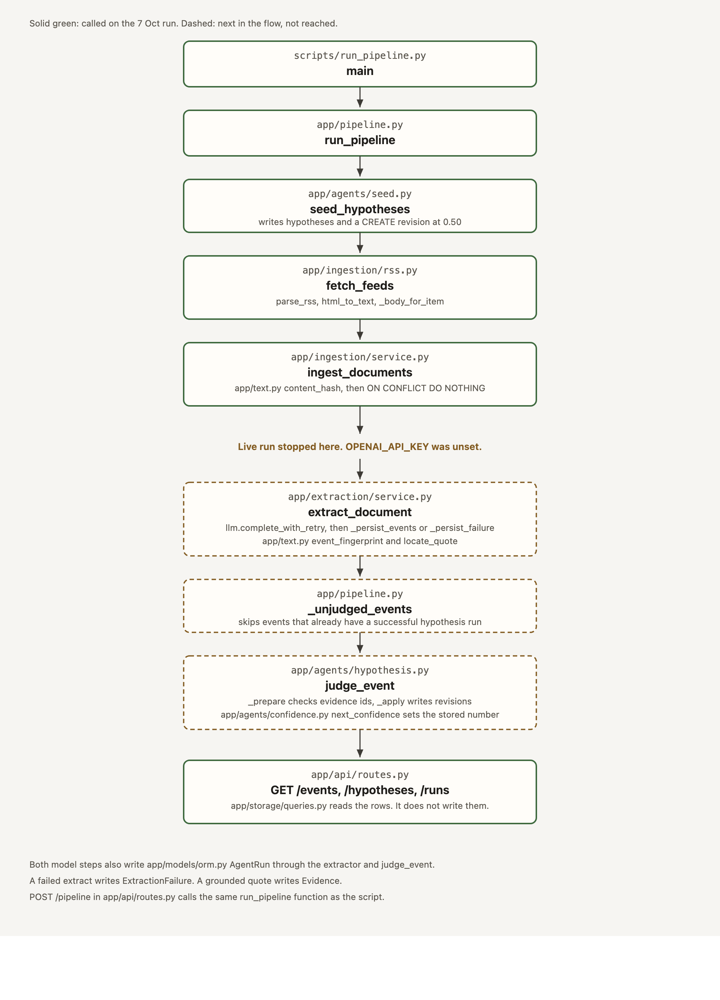

# Day 1 report

Day 1 built one path from a public article to a stored belief, and then ran that path with a model.

The 7 Oct command stored **30 documents** and **4 seeded hypotheses at 0.50**. The 10 Oct command, with `OPENAI_API_KEY` set, extracted **53 events**, updated **2 hypotheses**, and moved one seed from **0.50 to 0.62**. Schema validity was **100%**, grounded events **98%**, mean latency **2.8s**, and cost **$0.0805**. `pytest` passed 17 tests against a fake model. The commit is tagged `day-01`.

## Data flow



A feed item becomes a document only after it is normalized and hashed. The extractor is the first model call. It must return events, not a summary. Each event keeps the quote it came from as evidence. The hypothesis agent then decides what that quote does to a belief. Code, not the model, writes the new confidence. Both model calls are stored as agent runs. Swagger only reads.

## Code hit along that flow

The 7 Oct run stopped before the model. The 10 Oct run continued through `extract_document` and `judge_event`.



`scripts/run_pipeline.py` calls `run_pipeline`. That seeds beliefs, fetches the feeds, and inserts documents. With a key, the same function continues into `extract_document` and then `judge_event`. Opening Swagger does not run that path. `app/api/routes.py` only reads through `app/storage/queries.py`. `POST /pipeline` is the exception: it calls `run_pipeline` again.

## What each important piece does

**Ingestion** is the only door in. It reads three feeds, ten items each: OpenAI news, the NVIDIA blog, and the Hugging Face blog. If a feed body is shorter than 400 characters, it fetches the article URL and keeps the longer text. The idempotency key is a SHA-256 of the normalized title plus body. Insert is `ON CONFLICT DO NOTHING`. Feeding the same document 10 times creates 1 row and skips 9. That test passed.

**Source document** is the stored article. `published_at`, `fetched_at`, `occurred_at`, and `created_at` stay separate. The live run showed why that matters: NVIDIA items arrived with full text, and all 10 OpenAI article pages returned HTTP 403, so those rows are the short RSS blurb. Two Hugging Face items are short as well.

**Extractor** is built, covered by tests, and ran on 10 Oct. It sends one document to OpenAI structured output. A valid response becomes economic events, fingerprinted so the same claim cannot be inserted twice for one document. An invalid response is retried once, then written to `extraction_failures` with the raw output. A document that already succeeded is skipped on the next run.

**Evidence** is its own table, not a string on the event. `grounded` is true only when the whitespace-normalized quote is a substring of the document. Character spans are filled when the raw quote appears unchanged. The hypothesis agent is only allowed to cite evidence ids that belong to the event it is judging. Any other id fails that run.

**Hypothesis agent** sees one event at a time, ordered by `published_at`, then `fetched_at`. It may `CREATE`, `SUPPORT`, `CONTRADICT`, `MODIFY`, or `IGNORE`. The suggested confidence is saved on the revision and then ignored.

**Confidence** lives in `app/agents/confidence.py`:

| Action | Stored confidence |
|---|---|
| CREATE | 0.50 |
| SUPPORT | +0.06 |
| CONTRADICT | −0.08 |
| MODIFY | +0.02, and the statement is replaced |
| IGNORE | unchanged |

The result is clamped to 0.05–0.95. A hypothesis row has no confidence column. The current number is the latest revision, so the history cannot be overwritten.

**Agent run** is the observability row: agent, model, input, output, tokens, latency, cost, status, error, and time. Cost uses the price table in config. An unknown model stores a null cost.

**Read API** is Swagger, at `/docs`. It exposes events, hypotheses, the evidence cited by a hypothesis, and runs. `POST /pipeline` calls the same function as `scripts/run_pipeline.py`.

## What the live database contains

Four seed beliefs. Three stay at 0.50. Falling inference prices driven by provider competition is at 0.62 after two `SUPPORT` revisions (`0.50 → 0.56 → 0.62`). The model suggested 0.60 and 0.65. Those values are stored and were not applied.

- Falling inference prices are increasingly driven by provider competition rather than solely by improvements in base models. Confidence 0.62.
- Datacenter capital expenditure is accelerating faster than inference revenue. Confidence 0.50.
- Open-model releases are compressing API prices for equivalent capability within one quarter. Confidence 0.50.
- Chip supply, rather than power, remains the binding constraint on new training clusters. Confidence 0.50.

The eval file has two format examples and zero human labels, so recall and the false-positive rate are still unscored. `failure_taxonomy.md` has F1–F8 defined and nothing observed yet. The 10 Oct output is there to classify. Do not patch prompts from a guess.

## Measured run

`python scripts/run_pipeline.py` on 10 Oct 2026, with `OPENAI_API_KEY` set:

```
Fetched:              30
New documents:        0
Events extracted:     53
Extraction failures:  0
Hypotheses created:   0
Hypotheses updated:   2
Schema validity:      100%
Grounded events:      98%
Mean latency:         2.8s
Cost:                 $0.0805
```
