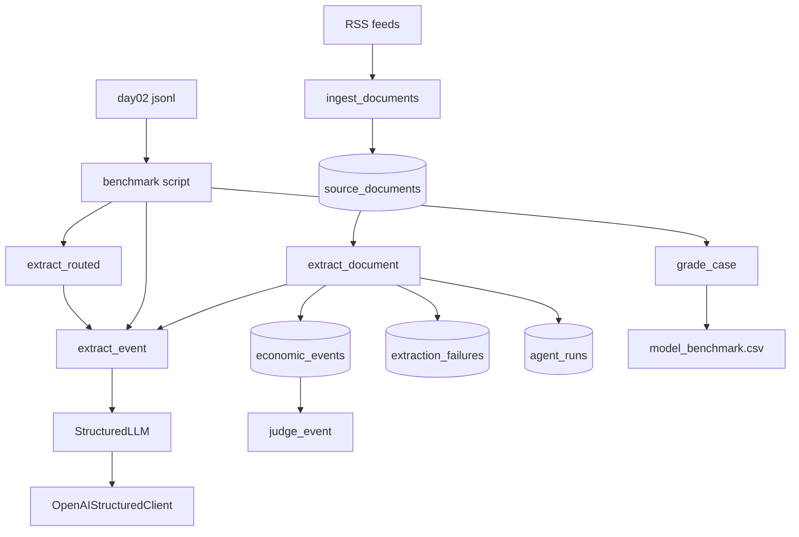
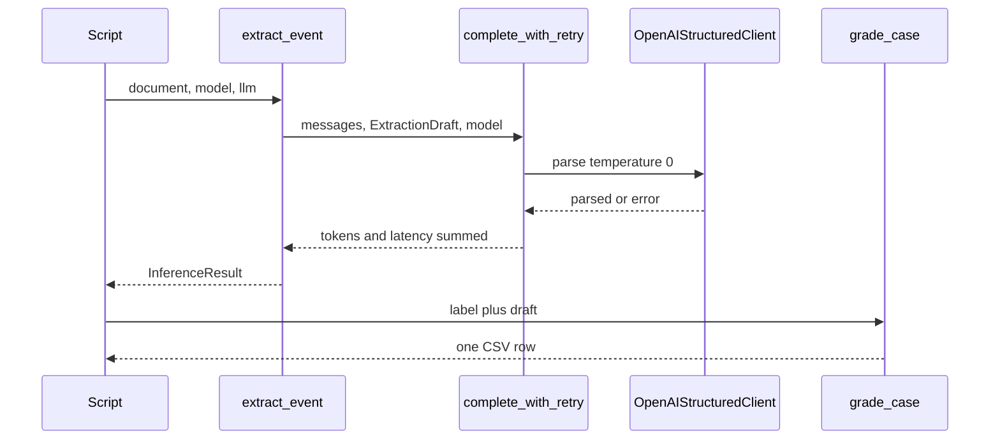
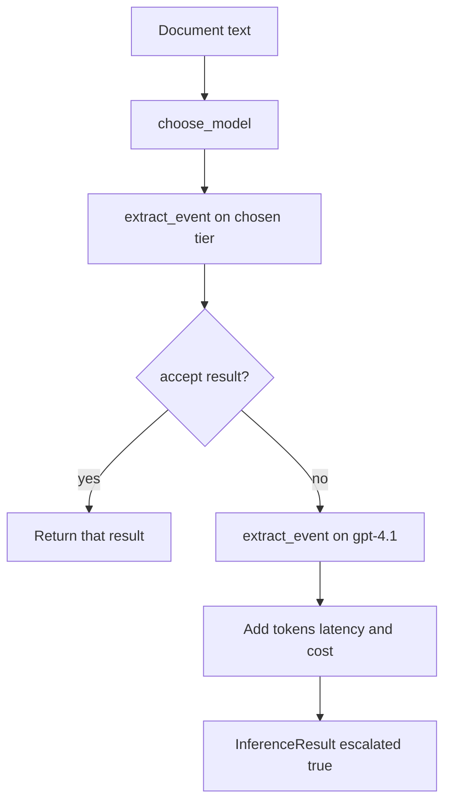

# Day 2: model evaluation and inference routing

Add a sync inference interface over the existing OpenAI client, score 30 hand-labeled documents across three model tiers, then route and escalate from the observed cheap-model failures without touching the hypothesis agent.

Day 1 already runs `SourceDocument` → structured model call → `EconomicEvent` or `ExtractionFailure`. The hypothesis agent exists and stays out of today’s work. The new work is an inference interface, a 30-case ground-truth set, a 90-run shootout, and a deterministic router.

Do not re-run [`scripts/run_pipeline.py`](scripts/run_pipeline.py) as the stability check. [`document_already_extracted`](app/extraction/service.py) skips documents that already have a successful extractor run, so a second pass prints zeros. Stability is `pytest` plus the fact that the 10 Oct run in [`DAY1.md`](DAY1.md) already recorded 53 events, 0 failures, 2.8s mean latency, and $0.0805 on `gpt-4.1-mini`.

## Two paths

The live desk still persists. The shootout never opens a write session. [`extract_document`](app/extraction/service.py) skips a second success, and the fingerprint unique key would collapse two models into one row. Eval fixtures must not move hypothesis confidence.

[`OpenAIStructuredClient`](app/extraction/llm.py) remains the only SDK owner. Tiers are model name strings passed through the existing `model` argument. Prices already live in [`app/config.py`](app/config.py):

- Cheap: `gpt-4.1-nano` at $0.10 / $0.40 per 1M tokens
- Mid: `gpt-4.1-mini` at $0.40 / $1.60, today’s default
- Strong: `gpt-4.1` at $2.00 / $8.00

Stay synchronous. Callers, SQLAlchemy, and [`FakeLLM`](tests/fakes.py) are sync.

## Inference result

New package, wrapping the client rather than moving it:

- [`app/inference/models.py`](app/inference/models.py) holds `InferenceResult` and the three tier constants.
- [`app/inference/provider.py`](app/inference/provider.py) holds `extract_event`.
- [`app/inference/router.py`](app/inference/router.py) holds `choose_model` and `extract_routed`.

`InferenceResult` fields: `output` as `ExtractionDraft | None`, `model`, `input_tokens`, `output_tokens`, `latency_ms`, `cost_usd`, `success`, `error`, plus `attempts` and `escalated` / `escalation_reason` / `route` so the router can record both calls. Output is the draft list, not one `EconomicEvent`. Empty `events` is a successful “no event” parse.

`extract_event(document, model, llm)` builds the same messages as [`extract_document`](app/extraction/service.py) (system prompt, title, url, published time, body capped at `MAX_PROMPT_CHARS`), calls [`complete_with_retry`](app/extraction/llm.py), and fills cost with [`compute_cost`](app/config.py). It accepts any object with `title`, `body`, `source_url`, and `published_at`, so a JSONL case does not need a database row. `SourceDocument` already has those fields.

`extract_document` calls `extract_event` and then keeps today’s persist / failure behavior. Existing extraction tests stay the persistence contract.

## One labeled case

A validation retry is not escalation. Escalation is a second model, later.

## Ground truth

[`evals/day02_event_extraction.jsonl`](evals/day02_event_extraction.jsonl): 30 lines, `label_status` = `labeled`, written before any shootout call. Each line contains the article text. An id alone cannot be scored.

Fields: `document_id`, `bucket`, `title`, `body`, `expected_event`, `expected_events` as a list of `{event_type, entities}`. Irrelevant lines use `expected_event: false` and an empty list. Multiple-event lines list every pair. Event types stay inside the existing enum in [`app/models/schemas.py`](app/models/schemas.py).

Buckets:

- obvious, 8: one stated event, one clear entity. Price cut, chip launch, capex figure, acquisition, funding round, datacenter site, model release, benchmark movement.
- subtle, 6: the event is stated without the label word. Availability instead of “release”, a price buried in packaging language, spend described as a plan, capacity described as power, a chip “sampling”, funding inside a partnership paragraph.
- irrelevant, 6: plausible AI posts with no economic event. Hiring, offsite, tutorial, conference agenda, culture essay, security patch.
- multiple, 5: two or three events in one body. Price plus release, capex plus site, funding plus acquisition, chip plus benchmark, and one three-event note.
- messy, 5: denied rumor, two companies with only one actor, contradictory magnitudes, a hypothetical price cut, an entity that could be OpenAI or Microsoft.

Bodies stay a few hundred words, with a few longer notes and a few multi-name notes so length and entity count can actually separate failures. Do not label the 53 stored events from 10 Oct.

## Score, locked before the paid run

New grader in [`app/evals/day02.py`](app/evals/day02.py). Reuse the type-plus-entity match in [`app/evals/score.py`](app/evals/score.py): case-insensitive entity containment. Do not change that match after seeing outputs.

A case is **correct** only when `success` is true and:

- no event expected: zero extracted events
- one expected pair: exactly one extracted event matches type and entity
- several expected pairs: every pair matches something, and nothing extra remains

Per-row flags:

- `schema_valid`: parsed draft, error is empty
- `event_type_correct` / `entity_correct`: the expected pair was found. On an irrelevant document both are true only when the model returned nothing

Aggregates, computed from the CSV, not stored per row:

- accuracy: correct cases / 30
- schema validity: valid parses / 30
- recall: expected-event cases where every expected pair was found, divided by the count of cases with `expected_event: true` (24)
- precision: cases where the model emitted at least one event and the document truly had an event, divided by cases where it emitted at least one event
- mean latency, mean cost per run
- cost per correct: sum of `cost_usd` / correct count. Zero correct is `undefined`, not zero

Token cost still uses the configured per-million rates. An errored call keeps whatever usage came back and counts as incorrect.

## Shootout

[`scripts/run_day02_benchmark.py`](scripts/run_day02_benchmark.py) loops 30 cases times the three tiers. One provider exception becomes that row’s `error` and the loop continues. Temperature stays 0.

[`experiments/day02/model_benchmark.csv`](experiments/day02/model_benchmark.csv) columns: `case_id`, `bucket`, `model`, `correct`, `schema_valid`, `event_type_correct`, `entity_correct`, `latency_ms`, `input_tokens`, `output_tokens`, `cost_usd`, `error`.

The script prints the six-metric table: accuracy, schema validity, recall, average latency, cost per run, cost per correct. Short documents should land near a cent for nano, a few cents for mini, and under about $0.10 for `gpt-4.1` across 30 calls. Stop if the first call fails auth. Do not print the API key.

[`experiments/day02/baseline.md`](experiments/day02/baseline.md) records the 10 Oct live run: model `gpt-4.1-mini`, 30 source documents, 53 successful extractions, 0 failures, 2.8s average latency, about $0.0805. That is the pre-routing desk, separate from the 30-case exam.

## Where cheap fails

After the CSV exists, read only the incorrect `gpt-4.1-nano` rows and write [`experiments/day02/failure_analysis.md`](experiments/day02/failure_analysis.md). Do not edit the system prompt.

Categories, mapped onto [`failure_taxonomy.md`](failure_taxonomy.md) so the vocabulary stays one language:

- F1 missed event, existing F1
- F2 wrong event type, existing F4
- F3 wrong entity, existing F3
- F4 hallucination, existing F2
- F5 malformed schema, existing F6
- F6 multiple-event confusion, new
- F7 ambiguity or reasoning failure, nearest existing F5

For each miss, note word count, distinct organization-like names, numbers, contradiction, and bucket. The last section answers which of those features showed up on cheap failures and not on cheap successes. Those features are the only inputs allowed in `choose_model`.

## Router v0

`choose_model` is deterministic and sees the document only. First version, adjusted only if the failure notes contradict it:

- long body, above the length that separated nano misses: `gpt-4.1`
- more than four organization-like names: `gpt-4.1-mini`
- otherwise: `gpt-4.1-nano`

Entity count is a crude capitalized-phrase count, not a model call. Word count is `len(body.split())`. Put both cutoffs as named constants at the top of [`app/inference/router.py`](app/inference/router.py) and set them from the failure notes before the router benchmark.

`extract_routed` accepts the first result when all of these hold:

- schema valid
- every `evidence_quote` is grounded by [`locate_quote`](app/text.py)
- at most one event
- no event typed `OTHER`
- every event confidence is at least 0.6

An empty event list is acceptable. Escalating every empty parse would tax the six irrelevant documents. Schema failure, an ungrounded quote, two or more events, `OTHER`, or low confidence triggers one strong call. No third model, and no model that picks the model.

The returned result uses the last model name, `escalated=true`, the reason string, and the **sum** of both calls’ tokens, latency, and cost.

## Router versus strong-only

[`scripts/run_day02_router.py`](scripts/run_day02_router.py) runs the same 30 cases through `extract_routed` only. Strong-only numbers are the `gpt-4.1` rows already in the CSV. Do not pay for those 30 calls again.

[`experiments/day02/router_results.md`](experiments/day02/router_results.md) reports accuracy, total cost, mean latency, escalation rate, and savings versus strong-only. A router that costs more and scores worse is written down as the result.

Scale measured mean dollars per document, not the rate card, to 1,000, 100,000, and 1,000,000 documents for strong-only and for the router. State the operating point: a few RSS feeds a day do not feel a 50% saving; a continuous multi-source ingest does. Expensive calls belong on long, multi-name, or failed-validation documents.

## Tests

No network in `pytest`.

- `extract_event` with [`FakeLLM`](tests/fakes.py) returns tokens, cost, and a draft, and does not require a session.
- Grader fixtures cover irrelevant, exact match, extra event, and a two-event case.
- Router: a short clean fake stays on nano; an invalid parse escalates and the result cost equals both fake calls; two extracted events escalate; an empty draft does not.

## Ship

Stage only the Day 2 paths. Do not `git add .`. That would pick up the deleted `.env.example`, untracked [`DAY1.md`](DAY1.md), diagram files, and must not pick up `.env`.

Commit message: `day02: model evaluation and inference routing`. Tag `day-02`.

Done when the five answers are filled from the CSV and router file: which tier won, by how many correct cases, the cost ratio, the dominant nano failure category, and whether the router kept most of the strong accuracy at a lower total cost.

## Checklist

- Write `experiments/day02/baseline.md` from the 10 Oct live run; confirm pytest still passes
- Add `InferenceResult`, `extract_event`, and tier constants; route `extract_document` through `extract_event` without changing persistence
- Author 30 hand-labeled cases in `evals/day02_event_extraction.jsonl` across the five buckets
- Implement day-02 grading and locked accuracy, precision, recall, and cost-per-correct rules, with unit tests
- Run 30 cases on nano, mini, and gpt-4.1; write `model_benchmark.csv` and the comparison table
- Classify cheap-model misses into F1–F7 and record which document features predict them
- Implement `choose_model` and `extract_routed` with summed cost and escalation tests
- Benchmark the router against the existing strong-only rows; write `router_results.md` including volume extrapolation
- Commit only Day 2 paths and tag `day-02`
