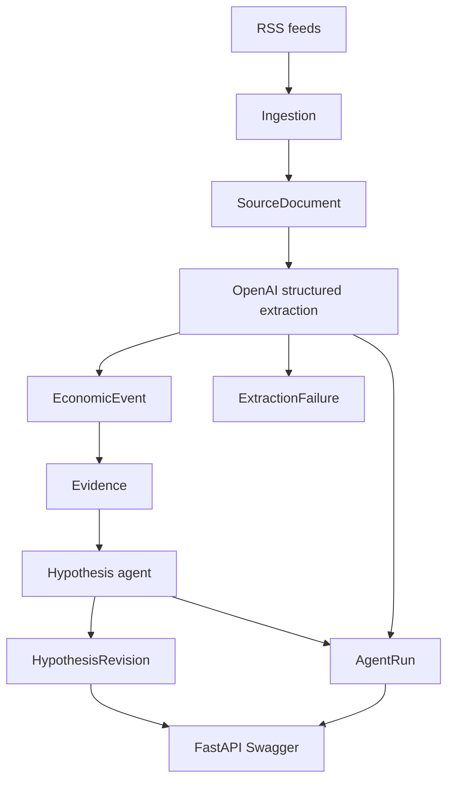

# Autonomous Intelligence Desk

The repo root is this workspace. Gate commands run from here: `docker compose up`, `pytest`, `uvicorn app.main:app --reload`, `python scripts/run_pipeline.py`.

Phase 1 is the build. Phases 2–4 are gates, not designs. A phase is done only when the capability is true in Postgres and in the eval output.



## Phase 1 — Slice

One RSS connector, one extractor, one hypothesis agent. No LangGraph, Temporal, Redis, Kafka, or vector database. Sync SQLAlchemy 2 is enough. FastAPI calls the same pipeline functions as the script.

### Data model

All ids are UUID4. All timestamps are timezone-aware. Do not collapse these clocks: `published_at`, `fetched_at`, `occurred_at`, `created_at`.

- `source_documents`: `source_type`, `source_url`, `title`, `body`, `published_at`, `fetched_at`, `content_hash`. Unique on `content_hash`. Hash is SHA-256 of normalized title plus body.
- `economic_events`: extracted fields (`event_type`, `entities`, `claim`, `occurred_at`, `magnitude`, `unit`, model `confidence`). Unique on `(source_document_id, event_fingerprint)` where the fingerprint hashes type, claim, and entities. A second extraction of a document that already succeeded is a skip.
- `extraction_failures`: `source_document_id`, raw model output, error text, `agent_run_id`. Schema failures are rows, never logs that get dropped.
- `evidence`: `event_id`, `source_document_id`, `quote`, best-effort `char_start` / `char_end`, `grounded` set by code. Grounded means the whitespace-normalized quote is a substring of the document body.
- `hypotheses`: stable id and current statement only. Confidence is not a column on this table.
- `hypothesis_revisions`: append-only. `action`, `reasoning`, `statement_before`, `statement_after`, `confidence_before`, `confidence_after`, `model_suggested_confidence`, `event_id`, `agent_run_id`. Unique on `(hypothesis_id, event_id)` so a re-run cannot move the same belief twice.
- `revision_evidence`: revision id to evidence id. The agent may cite only evidence ids that belong to the event just processed. Any other id fails that run.
- `agent_runs`: `agent`, `model`, `input`, `output`, token counts, `latency_ms`, `cost_usd`, `status`, `error`, `created_at`. Cost uses a price table in config, USD per 1M tokens. Unknown model prices stay null.

Event types are a closed enum plus `OTHER`: `MODEL_RELEASE`, `PRICE_CHANGE`, `CAPEX_ANNOUNCEMENT`, `CHIP_RELEASE`, `DATACENTER_EXPANSION`, `ACQUISITION`, `FUNDING`, `BENCHMARK_CHANGE`.

### Confidence rule

The model chooses `action`, `reasoning`, `evidence_ids`, an optional `proposed_hypothesis`, and an optional suggested confidence. Code ignores the suggested confidence except to store it.

- `CREATE` starts at `0.50`
- `SUPPORT` adds `0.06`
- `CONTRADICT` subtracts `0.08`
- `MODIFY` adds `0.02` and replaces the statement
- `IGNORE` writes a revision and leaves confidence unchanged
- Clamp every result to `[0.05, 0.95]`

Seed four hypotheses idempotently by statement text, including: falling inference prices are increasingly driven by provider competition rather than solely by base-model improvements. The other three are datacenter capex versus utilization, open-model releases compressing API prices, and chip supply as the binding constraint on training clusters.

### Pipeline

One function in [`app/pipeline.py`](app/pipeline.py) does fetch, normalize, hash, dedup, extract, and belief update. [`scripts/run_pipeline.py`](scripts/run_pipeline.py) and the API both call it.

Ingestion is one RSS connector (`httpx`) with feeds in config. Start with public company feeds (OpenAI news, NVIDIA blog, and one more that returns real entries). Persist `source_type="rss"`. Insert with `ON CONFLICT (content_hash) DO NOTHING`.

Extraction uses the official OpenAI SDK structured-output parse path, isolated in [`app/extraction/llm.py`](app/extraction/llm.py). Default model is a small structured-output model set by `OPENAI_MODEL`. The model returns events. It does not summarize. One validation retry, then an `extraction_failures` row and an errored `agent_runs` row. The hypothesis agent runs events in `published_at` then `fetched_at` order, one event at a time, against current hypotheses.

### API

Swagger is the UI. Endpoints: `GET /events`, `GET /events/{id}`, `GET /hypotheses`, `GET /hypotheses/{id}`, `GET /hypotheses/{id}/evidence`, `GET /runs`, plus `GET /health`. Hypothesis detail includes the revision trajectory. Evidence for a hypothesis is the evidence cited by its revisions.

### Tests and eval

`pytest` must pass with Postgres from Compose and no API key. Mock the LLM wrapper.

- Same document ingested 10 times: `documents_created == 1`, `duplicates_skipped == 9`
- Invalid model output creates an `extraction_failures` row
- Extracting a document twice does not duplicate events
- `SUPPORT` / `CONTRADICT` follow the code rule even when the model suggests a different confidence
- An evidence id from another event is rejected

[`evals/day1_event_extraction.jsonl`](evals/day1_event_extraction.jsonl) is the labeled-set format: document id or fixture text, expected event types, expected entities. Ship the scorer and two format examples. Recall and false-positive rate print as unscored until 20 human labels exist. Do not label from model output. Schema-valid rate, grounding, mean latency, and cost come from `agent_runs` and evidence rows on the live run.

[`failure_taxonomy.md`](failure_taxonomy.md) lists F1 missed event, F2 hallucinated event, F3 wrong entity, F4 wrong event type, F5 unsupported claim, F6 malformed output, F7 duplicate event, F8 confidence badly calibrated, each with an empty observed section.

### Ship bar

[`README.md`](README.md) covers what the system is, the diagram, how to run, the pipeline, the data model, eval results from the actual run, known failures, and the Phase 2 questions. [`docker-compose.yml`](docker-compose.yml) is Postgres only. [`.env.example`](.env.example) has `DATABASE_URL`, `OPENAI_API_KEY`, `OPENAI_MODEL`, and prices.

`python scripts/run_pipeline.py` prints measured counts in this shape, using whatever the run actually produced:

```
Fetched:
New documents:
Events extracted:
Extraction failures:
Hypotheses created:
Hypotheses updated:
Schema validity:
Grounded events:
Mean latency:
Cost:
```

Commit and tag `day-01` only after that command has been run and the README numbers match it.

## Phase 2 — Lineage gate

Not built in this pass. Start it only after Phase 1 has a real run.

Done when a single command prints, for any hypothesis confidence, the revision, agent run, evidence quote, character span, and source document, and replaying the revision log reproduces the current confidence. Character spans become required. The same announcement fetched from two URLs collapses to one event instead of two beliefs.

## Phase 3 — Dependability gate

Done when 20 documents were labeled before looking at extractor output, and the scorer reports schema validity, recall, false positives, grounding, latency, and cost per document. A second OpenAI model tier runs the same frozen inputs. A prompt or model change is allowed only against a counted F1–F8 row.

## Phase 4 — Measured failure gate

No design now. Add a queue, cache, retrieval index, or a second agent only when a Phase 3 result names a failure that the current process cannot absorb.
