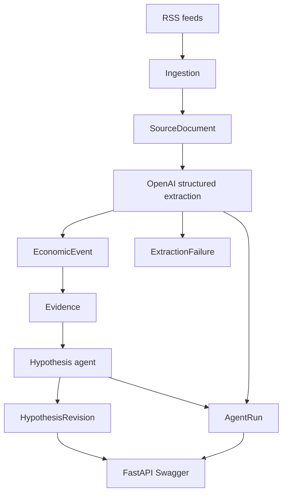

# Autonomous Intelligence Desk

The desk watches public writing about AI infrastructure and keeps a small set of beliefs. A belief changes only when a quoted event supports, contradicts, or modifies it. The confidence number is computed by code. The model proposes the action and the quote.

This repository is Phase 1: one RSS connector, one extractor, and one hypothesis agent. Later phases stay closed until this path has a real model run.



## How to run

```bash
docker compose up -d
python -m venv .venv
source .venv/bin/activate
pip install -e ".[dev]"
alembic upgrade head
cp .env.example .env
```

Put an OpenAI key in `.env`. `OPENAI_MODEL` defaults to `gpt-4.1-mini`. Prices are the `MODEL_PRICES` table in that file, USD per 1M tokens. An unknown model stores a null cost.

```bash
pytest
uvicorn app.main:app --reload
python scripts/run_pipeline.py
```

Swagger is the UI at `/docs`. The read endpoints are `GET /events`, `GET /events/{id}`, `GET /hypotheses`, `GET /hypotheses/{id}`, `GET /hypotheses/{id}/evidence`, and `GET /runs`. `POST /pipeline` calls the same `run_pipeline` function as the script. `GET /health` does not touch the database.

`pytest` uses the Compose Postgres and a `desk_test` database. It does not call OpenAI.

## Current pipeline

`app/pipeline.py` is the only write path.

1. Seed four hypotheses if they are not already stored.
2. Fetch the configured RSS feeds (OpenAI news, NVIDIA blog, Hugging Face blog), ten items each.
3. When the feed body is shorter than 400 characters, fetch the article URL and keep the longer text.
4. Hash the normalized title and body. Insert with `ON CONFLICT DO NOTHING`.
5. Ask the model for structured events. One validation retry, then an `extraction_failures` row. A document that already extracted successfully is skipped.
6. Each event is an `Evidence` row. `grounded` is true when the whitespace-normalized quote is a substring of the document. Character spans are set when the raw quote appears unchanged.
7. The hypothesis agent sees one event at a time, in `published_at` then `fetched_at` order. It may `CREATE`, `SUPPORT`, `CONTRADICT`, `MODIFY`, or `IGNORE`.
8. Code applies confidence: create `0.50`, support `+0.06`, contradict `-0.08`, modify `+0.02`, ignore `+0`. Clamp to `[0.05, 0.95]`. The model's suggested confidence is stored and not applied.

Re-running the script does not duplicate documents, events, or seed beliefs.

## Data model

Ids are UUID4. Timestamps are timezone-aware. `published_at`, `fetched_at`, `occurred_at`, and `created_at` stay separate.

- `source_documents` — unique on `content_hash`
- `economic_events` — unique on `(source_document_id, event_fingerprint)`
- `extraction_failures` — schema failures, with the raw model output
- `evidence` — quote, optional span, `grounded`
- `hypotheses` — statement only. Confidence is not a column
- `hypothesis_revisions` — append-only. Unique on `(hypothesis_id, event_id)` when the event is present
- `revision_evidence` — which quotes a revision cited
- `agent_runs` — agent, model, input, output, tokens, latency, cost, status, error, timestamp

Event types are `MODEL_RELEASE`, `PRICE_CHANGE`, `CAPEX_ANNOUNCEMENT`, `CHIP_RELEASE`, `DATACENTER_EXPANSION`, `ACQUISITION`, `FUNDING`, `BENCHMARK_CHANGE`, and `OTHER`.

## Today's eval results

`python scripts/run_pipeline.py` on 7 Oct 2026, without `OPENAI_API_KEY`:

```
Fetched:              30
New documents:        30
Events extracted:     0
Extraction failures:  0
Hypotheses created:   4
Hypotheses updated:   0
Schema validity:      n/a
Grounded events:      n/a
Mean latency:         n/a
Cost:                 n/a
```

The four hypotheses are the seeds, at confidence 0.50. The extractor and the hypothesis agent did not run, so schema validity, grounding, latency, and cost are not measured.

`evals/day1_event_extraction.jsonl` contains two format examples and zero human labels. Event recall and the false-positive rate stay unscored until 20 records have `"label_status": "labeled"`. Do not label those from model output. `python -m app.evals.score` reads the file and joins it to stored events.

`pytest`: 17 passed.

## Known failures

Observed on this run, before any model call:

- OpenAI article pages returned HTTP 403, so all 10 OpenAI documents are the RSS blurb. Two Hugging Face items are also under 400 characters. NVIDIA's feed included full text.
- Model metrics are unmeasured because `OPENAI_API_KEY` was unset.

`failure_taxonomy.md` lists F1–F8. The observed sections are empty until a model run is reviewed. Do not patch prompts from a guess.

## Phase 2 questions

Start these only after a run that actually calls the model.

- Can one command print, for any current confidence, the revision, agent run, evidence quote, character span, and source document?
- Does replaying the revision log reproduce that confidence?
- Can the same announcement fetched from two URLs collapse to one event?
- Which of F1–F8 shows up once 20 documents are labeled before looking at the extractor?
